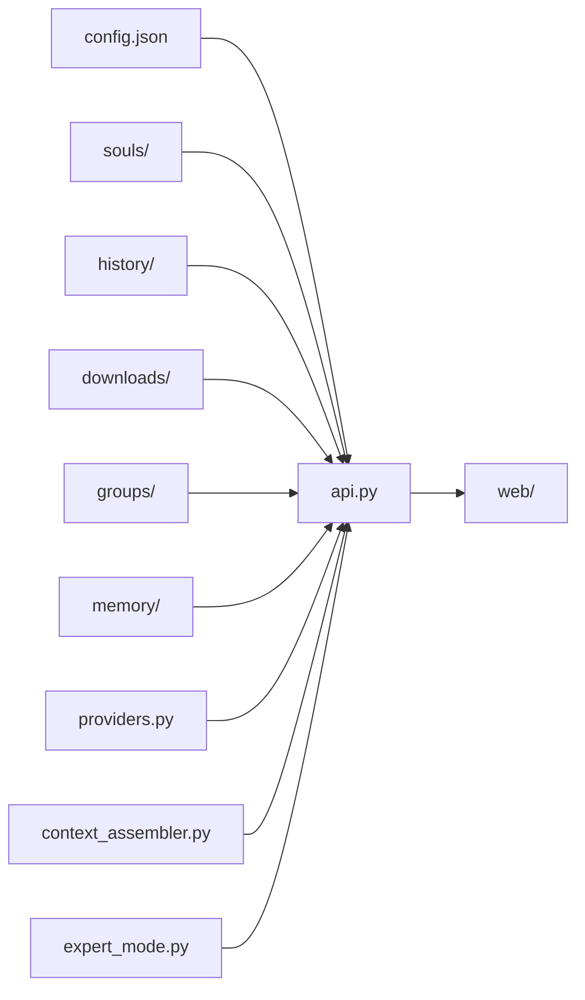

# MeClaw 项目结构（目录地图）

> **给 AI / 新同学：** 先读本文件。查接口/DOM/config → [API参考.md](./API参考.md)。对话文件目录 → [对话文件目录设计.md](./对话文件目录设计.md)。流程规矩 → [迭代更新文档.md](./迭代更新文档.md)。根目录 → [README.md](../README.md)。

---

## 路径约定

| 概念 | 路径 | 说明 |
|------|------|------|
| **应用根目录** | `main.py` 所在目录 | 如 `<应用根目录>`；勿写死盘符 |
| **本地配置** | `config.json` | 含 API Key，已在 `.gitignore`；模板见 `config.example.json` |
| **运行时 · 对话** | `history/` | `sessions.json` + `{id}.json` + `summaries/{id}_summary.md` |
| **运行时 · 文件** | `downloads/` 或 `receive_dir` | 按对话：`{根}/{对话ID}/files/`，见设计文档 |
| **人设** | `souls/{bot-id}/` | config 中 `soul_folder` 用 **`souls/xxx` 相对路径** |
| **群聊** | `groups/` | `groups.json` 索引 + `{group-id}/meta.json` + `memory/` |
| **规格驱动开发** | `openspec/` | OpenSpec 变更提案与主规格 |

**路径解析：** `backend/api.py` → `resolve_app_path()` / `to_config_relative_path()`。启动时会把 Bot 的绝对路径 `soul_folder` 自动改相对并写回 config。

---

## 目录树

```
meclaw/
├── README.md
├── main.py                       # 入口（转发 backend.main.start）
├── config.json                   # 本地配置（git 忽略）
├── config.example.json           # 配置模板
├── requirements.txt
├── .gitignore
├── CLAUDE.md
├── build.bat
├── 启动MeClaw.bat
├── 启动MeClaw(调试).bat
├── 启动MeClaw.vbs
├── 创建桌面快捷方式.bat
│
├── history/                      # [运行时] 对话历史，勿提交
│   ├── sessions.json             # 会话索引（含 bot_id / group_id / mode）
│   ├── {session-id}.json         # 单会话消息
│   └── summaries/
│       └── {session-id}_summary.md
├── downloads/                    # [运行时] 对话文件根，勿提交
├── groups/                       # [运行时] 群聊数据
│   ├── groups.json               # 群聊索引
│   └── {group-id}/
│       ├── meta.json             # 群聊配置（成员、自动互动等）
│       └── memory/               # 群级记忆（结构同 bot memory/）
│
├── assets/                       # 静态资源
├── souls/                        # Bot 人设目录
│   ├── README.md
│   ├── default/soul.md
│   └── {bot-id}/
│       ├── soul.md               # 身份人格（必须小写）
│       ├── constraints.md        # 约束规则（可选）
│       ├── memory.md             # 长期记忆索引 + 精华摘要
│       ├── knowledge/            # 静态知识（全量加载，可选）
│       └── memory/               # 可检索记忆
│           ├── index.sqlite      # FTS 索引
│           ├── scratchpad.md     # 专家模式草稿纸（运行时）
│           ├── entries/          # 主格式：Markdown 结构化条目
│           ├── items/            # 遗留 JSON 条目 + quote 收藏
│           │   ├── fact/
│           │   ├── preference/
│           │   ├── project/
│           │   ├── relationship/
│           │   └── quote/
│           └── docs/             # 长文收藏（分块）
│
├── skills/                       # 技能目录
│   ├── code-review/
│   │   ├── skill.json
│   │   └── instructions.md
│   └── web-search/
│       ├── skill.json
│       └── instructions.md
│
├── openspec/                     # OpenSpec 规格与变更
│   ├── config.yaml
│   ├── specs/                    # 已归档主规格
│   └── changes/                  # 进行中 / archive/ 已完成
│
├── .claude/ / .cursor/           # AI 工作流命令与 OpenSpec skills
│
├── backend/
│   ├── __init__.py
│   ├── api.py                    # MeClawAPI 基类（配置、Bot/Profile、消息、流式 API）
│   ├── main.py                   # MeClawAPIWithFiles 扩展 + pywebview 启动
│   ├── providers.py              # 多供应商适配（OpenAI/Anthropic/DeepSeek）
│   ├── expert_mode.py            # 专家模式三阶段管道 + scratchpad
│   ├── expert_helpers.py         # 专家/会议共用流式调用、置信度解析
│   ├── expert_council.py         # 群聊专家会议四轮编排 + 仲裁
│   ├── shared_blackboard.py      # 会议共享黑板（冻结+追加）
│   ├── context_assembler.py      # Prompt Caching 友好的上下文组装
│   ├── file_ops.py               # 工作区文件操作
│   ├── history.py                # 对话历史 CRUD + summaries
│   ├── session_files.py          # 按对话隔离的 files 目录
│   ├── soul.py                   # 灵魂文件夹加载
│   ├── skills.py                 # 技能扫描与管理
│   ├── code_mode.py              # 编程模式 read_files
│   ├── web_search.py             # 联网检索（agent loop）
│   ├── groups.py                 # 群聊 CRUD + 群记忆目录
│   ├── group_mentions.py         # @mention 解析与回复链
│   └── memory/                   # 记忆系统
│       ├── __init__.py
│       ├── config.py             # 记忆配置读取
│       ├── constants.py          # 常量
│       ├── store.py              # 文件存储（entries/items/docs）
│       ├── indexer.py            # SQLite FTS 索引
│       ├── retrieval.py          # 搜索与排序
│       ├── extractor.py          # LLM 提取记忆（entries 优先）
│       ├── intent.py             # 长文检索意图规则
│       └── compress_prompts.py   # 压缩提示词
│
├── web/
│   ├── index.html                # 页面结构
│   ├── style.css                 # 样式（暗色/亮色主题）
│   ├── app.js                    # 主入口、事件绑定、模式切换
│   └── js/
│       ├── utils.js              # 工具函数
│       ├── config.js             # 配置管理、设置弹窗
│       ├── providers.js          # 供应商（API Profiles）设置 UI
│       ├── chat.js               # 对话核心、专家模式、联网时间线
│       ├── bot.js                # Bot 管理、上下文进度条、状态面板
│       ├── sidebar.js            # 侧边栏（Bot/会话/文件/状态）
│       ├── group.js              # 群聊导航、建群、@ 成员、急停
│       ├── composer.js           # 输入区工具条（思考模式 / 技能）
│       ├── memory.js             # 记忆库管理（状态面板）
│       ├── code-editor.js        # 编程模式可编辑文件区
│       ├── code-layout.js        # 编程模式面板布局持久化
│       ├── preview.js            # 文件预览
│       ├── ops.js                # 文件操作确认、压缩
│       └── marked.min.js         # Markdown 渲染库
│
└── docs/
    ├── 系统结构.md
    ├── API参考.md
    ├── 记忆系统技术文档.md
    ├── 记忆系统使用帮助.md
    ├── 对话文件目录设计.md
    ├── 联网与MCP预留.md
    ├── 迭代更新文档.md
    └── 开工文档/
```

---

## 模块职责（速查）

### 后端核心

| 位置 | 职责 |
|------|------|
| `backend/api.py` | 配置迁移、Bot/Profile 管理、消息组装、流式 API、路径相对化、记忆检索注入 |
| `backend/main.py` | 文件树、会话、Bot/群聊 CRUD、记忆 API、压缩、接收目录、pywebview |
| `backend/providers.py` | 多供应商适配层：统一 build_headers/endpoint/payload/parse_response |
| `backend/expert_mode.py` | 专家模式三阶段管道（解构→发散→收敛），`memory/scratchpad.md` 持久化 |
| `backend/context_assembler.py` | Prompt Caching 友好的上下文组装（stable/semi_stable/dynamic 三层） |

### 后端功能

| 位置 | 职责 |
|------|------|
| `backend/file_ops.py` | 工作区 file: 操作、备份、路径安全、编辑器保存 |
| `backend/history.py` | `history/` 会话 CRUD、搜索、导出、`summaries/` 管理 |
| `backend/session_files.py` | `{receive_root}/{session_id}/files/` 布局 |
| `backend/soul.py` | 加载 soul.md、constraints.md、memory.md、knowledge/ |
| `backend/skills.py` | 技能扫描；全局 + Bot 级启用 |
| `backend/code_mode.py` | 编程模式 read_files 管理 |
| `backend/web_search.py` | 联网检索 agent loop（Bing/DuckDuckGo/SerpAPI） |

### 后端群聊

| 位置 | 职责 |
|------|------|
| `backend/groups.py` | 群聊 CRUD；`groups/{id}/` 作群记忆根目录 |
| `backend/group_mentions.py` | @mention 解析、概率触发、回复链计算 |

### 后端记忆系统

| 位置 | 职责 |
|------|------|
| `backend/memory/store.py` | 文件系统存储（entries/items/docs） |
| `backend/memory/indexer.py` | SQLite FTS 索引构建与增量更新 |
| `backend/memory/retrieval.py` | FTS 搜索、related 条目扩展、token 预算控制 |
| `backend/memory/extractor.py` | 压缩时 LLM 提取；优先写 `entries/`，兼容 `items/` |
| `backend/memory/intent.py` | 长文 docs 检索意图关键词规则 |
| `backend/memory/config.py` | 记忆配置读取 |
| `backend/memory/compress_prompts.py` | 压缩提示词模板（含 detail 档位） |

### 前端

| 位置 | 职责 |
|------|------|
| `web/js/chat.js` | 发送、流式、思考块、专家模式 UI、联网时间线、群聊渲染 |
| `web/js/bot.js` | Bot 管理、模式徽章、上下文进度条、状态面板、API 日志 |
| `web/js/sidebar.js` | Bot 中心导航、会话、文件树、状态面板切换 |
| `web/js/group.js` | 群聊侧边栏、建群弹窗、@ 成员选择、急停 |
| `web/js/composer.js` | 输入区工具条（思考深度、技能开关） |
| `web/js/memory.js` | 记忆库浏览与管理（entries/items/docs） |
| `web/js/config.js` | 设置、全局技能、记忆/联网开关 |
| `web/js/providers.js` | 供应商设置 UI（卡片列表、编辑、测试、余额） |
| `web/js/code-editor.js` | 编程模式文件编辑与保存 |
| `web/js/code-layout.js` | 编程模式面板拖拽与布局持久化 |
| `web/js/preview.js` | 文件预览（语法高亮） |
| `web/js/ops.js` | 文件操作确认、压缩上下文 |

---

## 数据流



**会话模式：**
- **单 Bot 对话**：`sessions.json` 记录 `bot_id` + `soul_folder` + `mode`（`chat` / `code`）
- **群聊**：`group_id` + `member_bot_ids`；群记忆落在 `groups/{id}/memory/`
- **编程模式**：`working_dir` + `read_files`；文件操作经 `file_ops.py`

---

## config.json 结构

完整字段见 `config.example.json` 与 [API参考.md](./API参考.md)。核心结构：

```json
{
    "api_profiles": [
        {
            "id": "default",
            "name": "默认配置",
            "base_url": "https://api.openai.com/v1",
            "api_key": "sk-xxx",
            "model": "gpt-4o",
            "provider": "generic",
            "temperature": 0.7,
            "max_tokens": 4096,
            "max_context": 65536,
            "models": [
                { "id": "m1", "name": "gpt-4o", "tools": true, "reasoning": false }
            ],
            "enabled": true
        }
    ],
    "bots": [
        {
            "id": "default",
            "name": "默认助手",
            "avatar": "🤖",
            "profile_id": "default",
            "soul_folder": "souls/default",
            "model": "",
            "temperature": null,
            "max_tokens": null,
            "max_context": null,
            "thinking_enabled": false,
            "thinking_depth": "high",
            "web_search": false,
            "skills_use_global": true,
            "enabled_skills": []
        }
    ],
    "active_bot_id": "default",
    "user_avatar": "😎",
    "context_rounds": 10,
    "auto_save_history": false,
    "user_font_size": 14,
    "bot_font_size": 14,
    "thinking_font_size": 12,
    "receive_dir": "",
    "theme": "dark",
    "api_log_enabled": false,
    "editor_word_wrap": true,
    "enabled_skills": [],
    "web_search_provider": "bing_local",
    "web_search_api_key": "",
    "web_search_max_rounds": 3,
    "web_search_max_queries_per_round": 3,
    "memory_enabled": true,
    "memory_retrieval_enabled": true,
    "memory_write_enabled": true,
    "memory_auto_extract": false,
    "memory_token_budget": 1200,
    "memory_extract_threshold_pct": 85,
    "compress_summary_detail": "standard",
    "memory_organizer_enabled": false,
    "memory_organizer_profile_id": "",
    "memory_organizer_bot_id": ""
}
```

**Bot 与 Profile 分离：**
- `api_profiles` 负责「怎么连」：地址、密钥、默认模型、上下文上限、供应商类型
- `bots` 负责「是谁」：头像、灵魂文件夹、可覆盖的模型和参数
- 一个 API Profile 可以被多个 Bot 引用

**Bot 参数优先级：** Bot 自身 → Profile 默认 → 全局默认

**供应商类型（provider）：** `generic` | `deepseek` | `anthropic`

---

## 关键约束

| 项目 | 说明 |
|------|------|
| pywebview | 5.3.1（6.x 有 bug） |
| Python | 3.11+ |
| 上下文组装 | stable system → semi_stable → 对话历史 → dynamic 前缀（摘要/记忆/文件/时间） |
| soul.md | 必须小写文件名 |
| soul_folder | 相对路径 `souls/{id}` |
| 思考模式 | DeepSeek：`thinking_enabled` + `thinking_depth`；Anthropic：reasoning tokens |
| 专家模式 | 输入框 🎯 按钮临时切换，三阶段管道，草稿纸存 `memory/scratchpad.md` |
| 联网搜索 | tools agent loop，默认最多 3 轮；前端时间线 + 引用抽屉 |
| 群聊 | 多 Bot 对话，@mention 触发，自动互动概率链，群记忆在 `groups/{id}/memory/` |
| 记忆系统 | `entries/`（主）+ `items/`（遗留/quote）+ `docs/`；SQLite FTS；压缩时提取 |
| 多供应商 | `providers.py` 统一适配 OpenAI/Anthropic/DeepSeek 格式 |
| 侧边栏 | Bot 中心导航：先选 Bot/群，再选会话 |
| 勿提交 | `config.json`、`history/`、`downloads/`、`groups/` |

---

## 文档维护

| 变更 | 更新 |
|------|------|
| 目录/模块 | 本文件 |
| API/前端/config | `API参考.md` |
| 记忆系统 | `记忆系统技术文档.md` + `记忆系统使用帮助.md` |
| 对话文件目录 | `对话文件目录设计.md` |
| 联网/MCP | `联网与MCP预留.md` |
| 流程 | `迭代更新文档.md` |
| 功能规格 | `openspec/specs/` 或对应 change |
